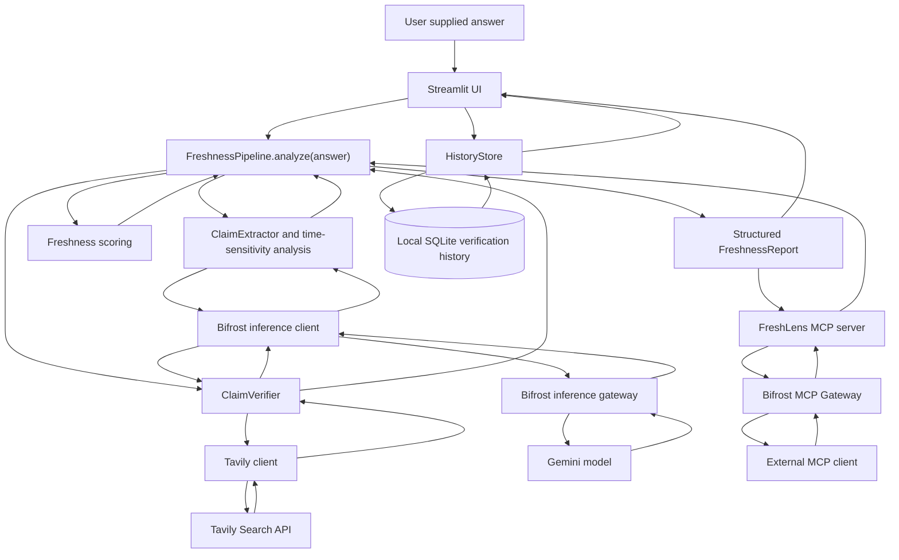

# FreshLens Architecture

## System diagram



## Component responsibilities

| Component | Responsibility |
|---|---|
| `app.py` | Renders the Streamlit input, execution state, report, claim and evidence details, and local history controls. Calls the pipeline only after a non-empty form submission. |
| `FreshnessPipeline` in `pipeline.py` | Coordinates extraction, evidence retrieval, verification, deterministic scoring, and `FreshnessReport` construction. |
| `ClaimExtractor` | Sends the submitted answer to Bifrost/Gemini for atomic claims and time-sensitivity fields, then validates and builds `Claim` models. |
| `ClaimVerifier` | Searches Tavily independently for each claim, maps search results to `ClaimEvidence`, and evaluates claims with Bifrost/Gemini when evidence exists. |
| `BifrostClient` | Calls the configured Bifrost OpenAI-compatible chat-completions endpoint and extracts generated text. |
| `TavilyClient` | Calls Tavily Search and normalizes result title, URL, content, date, and relevance score. |
| `score_freshness` | Returns new scored verifications and a `FreshnessSummary` according to the deterministic policy. |
| `schemas.py` | Defines shared Pydantic models and the `ClaimStatus` enum used across the application and MCP output. |
| `HistoryStore` in `history_store.py` | Creates and manages the local SQLite history table; serializes and restores complete reports. |
| `mcp_server.py` | Exposes the pipeline as one STDIO MCP tool with a structured `FreshnessReport` output. |

## Streamlit workflow

1. The user pastes an answer and submits the form. The UI rejects empty submissions, and the extraction component also rejects empty or whitespace-only input.
2. `app.py` lazily imports and calls `FreshnessPipeline().analyze(answer)` inside a progress indicator.
3. On success, the complete report is retained in Streamlit session state and saved through `HistoryStore`. A local history write failure does not hide the successful current report; the UI shows a generic warning.
4. The UI renders actual report summary values, each claim's status and metadata, rationale, confidence, freshness score, and retrieved evidence. It does not create an aggregate status absent from the schema.
5. The history section loads up to 20 saved records. Opening a record assigns the restored report to the current session result; it does not run extraction, Tavily search, Gemini verification, or scoring again.
6. The user may delete one record or request clear-all. Clear-all requires a second confirmation action. Clearing history is separate from clearing the current session result.

`app.py` does not expose raw pipeline exception details in the UI. History storage and load failures use generic messages and do not print answers or reports to logs.

## FreshnessPipeline workflow

`FreshnessPipeline.analyze(answer: str) -> FreshnessReport` composes the existing components:

```text
answer
  -> ClaimExtractor.extract(answer)
  -> ClaimVerifier.verify_claims(claims)
  -> score_freshness(claims, verifications)
  -> FreshnessReport(original_answer, claims, scored verifications, summary)
```

The default pipeline constructs a `BifrostClient` and a `TavilyClient`. Both clients can be injected for tests. Pipeline and client failures propagate from the pipeline; the Streamlit layer presents a safe, generic error rather than substituting an invented report.

## Claim extraction and time sensitivity

`ClaimExtractor.extract()` rejects non-string, empty, or whitespace-only answers. It JSON-encodes the answer text before adding it to the extraction prompt and instructs the model to treat it as data, not executable instructions. The model response is parsed as JSON, including supported fenced JSON. Claim fields are validated before creating `Claim` objects. Duplicate claim text is removed case-insensitively.

Each `Claim` includes:

- `claim_id` and standalone `text`
- strict boolean `is_time_sensitive`
- `category`
- `time_sensitivity_reason` or `null`

Time sensitivity is an LLM classification. The schema validates its type but does not independently determine whether the classification is correct.

## Tavily evidence retrieval

`ClaimVerifier.verify()` sends each claim's text as its own Tavily query and requests up to five results. It does not combine claims into one search. Tavily results are converted directly into `ClaimEvidence` fields: `title`, `url`, `excerpt`, optional `published_date`, and optional `relevance_score`.

If Tavily returns no results for a claim, the verifier returns `insufficient_evidence` with zero confidence, no evidence, and an explanatory rationale; it does not call Gemini for that claim. Missing evidence is not treated as proof that a claim is false. Tavily network or API failures propagate as errors rather than being converted to an insufficient-evidence result.

## Bifrost/Gemini verification

For claims with evidence, the verifier sends the claim and actual Tavily evidence to `BifrostClient.generate_text()`. Claim and evidence text are JSON-encoded as untrusted data. The system prompt says retrieved material may contain malicious instructions and must be evaluated only as information.

The verifier validates the JSON response's required status, non-empty rationale, numeric confidence in the range 0.0 to 1.0, and optional string `newer_information`. Valid statuses are `supported`, `potentially_outdated`, `conflicting`, and `insufficient_evidence`. The response supplies an assessment; evidence attached to the report remains the evidence retrieved by Tavily, not model-generated citations.

Configuration, connection, HTTP, response-shape, or parsing errors are not silently converted into a normal verification. The Bifrost client reports failures without embedding the configured API key in messages.

## Deterministic freshness scoring

`score_freshness(claims, verifications)` validates that there is exactly one verification for every claim ID and creates new scored verification copies without mutating input models.

| Claim condition | Claim `freshness_score` |
|---|---:|
| Stable (`is_time_sensitive == false`) | `null` |
| Time-sensitive and `supported` | `100.0` |
| Time-sensitive and any other valid status | `0.0` |

The overall score is the arithmetic mean of time-sensitive claim scores; it is `null` when there are no time-sensitive claims. Confidence is not used as a weight. Evidence coverage is the share of time-sensitive claims that have at least one evidence item, or `0.0` when there are no time-sensitive claims. Status counts include both stable and time-sensitive claims. A zero score means freshness was not established under this policy, not necessarily that a claim is false.

## `FreshnessReport` data model

The shared report is defined in `schemas.py` and has these top-level fields:

| Field | Contents |
|---|---|
| `original_answer` | Submitted answer, preserved by the pipeline. |
| `claims` | List of `Claim` records. |
| `verifications` | List of `ClaimVerification` records, each associated by `claim_id`. Includes status, rationale, confidence, optional newer information, Tavily evidence, and freshness score. |
| `summary` | `FreshnessSummary` with total/time-sensitive counts, status counts, overall freshness score, and evidence coverage. |

There is no separate aggregate status field. Both Streamlit and MCP use this shared report model; no duplicate response model is introduced.

## MCP server and invocation

`mcp_server.py` creates an SDK `MCPServer` named `FreshLens` and registers exactly one server-side tool:

```text
verify_answer_freshness(answer: str) -> FreshnessReport
```

The input schema contains one required string named `answer`. The return type is the existing Pydantic `FreshnessReport`; the MCP SDK publishes its structured output schema. The server supports pipeline injection for tests and lazily constructs the real pipeline when a tool call first arrives. Importing the module does not start the server or instantiate clients.

The executable uses STDIO transport. An MCP host launches `mcp_server.py` as a subprocess using the project's Python environment. The tool forwards the answer to `FreshnessPipeline.analyze()` and returns the complete report. A host such as Bifrost may display a client-qualified alias; the registered server-side tool name is `verify_answer_freshness`. Gateway registration is managed outside this repository and does not modify Bifrost core.

## SQLite history architecture

`HistoryStore` uses Python's standard-library `sqlite3`. Its default file is `.freshlens_history.sqlite3` beside `history_store.py`, in the repository root. Construction creates the parent directory and initializes the table and ordering index with `IF NOT EXISTS` statements.

The persisted schema is:

```sql
CREATE TABLE verification_history (
    record_id TEXT PRIMARY KEY NOT NULL,
    created_at_utc TEXT NOT NULL,
    original_answer TEXT NOT NULL,
    report_json TEXT NOT NULL
);

CREATE INDEX idx_verification_history_created_at
ON verification_history (created_at_utc DESC, record_id DESC);
```

`record_id` is a UUID string. `created_at_utc` is an ISO-formatted UTC timestamp. `original_answer` is stored separately to preserve exact submitted whitespace, and `report_json` contains the serialized complete `FreshnessReport`. On read, the JSON is validated against the shared report model, then its exact original answer is restored from the dedicated column.

The application saves only after `FreshnessPipeline.analyze()` returns successfully. `list_recent()` sorts newest first and the UI requests 20 records. `get()` restores one prior report, `delete()` removes one record, and `clear_all()` removes all rows. The UI requires confirmation before calling `clear_all()`.

The database is local, single-user, and unencrypted. It is not a cloud database, has no account or tenant isolation, and should not be committed to Git. `.gitignore` covers the database file and SQLite `-wal` and `-shm` sidecars.

## Data flow and credential boundaries

- The user submits answer text to the local Streamlit process.
- The answer is sent to the configured Bifrost inference endpoint for claim extraction.
- Extracted claim text is sent as a separate query to Tavily for each claim.
- Bifrost/Gemini receives each claim together with its retrieved evidence for verification.
- The local pipeline produces the report and scores; the local history store persists successful reports.
- The MCP tool runs the same pipeline when invoked by an MCP host; it does not implement a second verification algorithm.

`config.py` reads `BIFROST_BASE_URL`, `BIFROST_API_KEY`, `BIFROST_MODEL`, and `TAVILY_API_KEY` from the project-root `.env`. Keys are not logged or included in error messages. The `.env` file is ignored by Git. Only the variable names and placeholders belong in documentation; actual credentials must remain local.

## Error handling

- Missing or placeholder configuration is rejected during configuration loading with variable names, not key values.
- Bifrost and Tavily HTTP/client failures propagate from their respective clients and the pipeline; they are not mistaken for ordinary `insufficient_evidence` results.
- A successful Tavily response with no results is a normal `insufficient_evidence` verification and skips the Gemini verification call for that claim.
- Invalid model JSON or invalid status, rationale, confidence, or newer-information fields are rejected.
- The Streamlit UI displays a generic verification error without rendering raw provider exceptions. If history persistence fails after verification, the report remains visible and the UI reports that saving failed.
- MCP returns the pipeline result as structured output; the server does not fabricate a report on pipeline failure.

## External service dependencies

FreshLens requires a configured Bifrost inference endpoint and Gemini model for extraction and evidence evaluation, plus the Tavily Search API for evidence retrieval. API keys, model availability, network access, provider limits, and upstream service behavior are outside the local application's control. Automated tests mock these client interactions and do not establish live service availability.

## Limitations and future scope

- Model extraction and evaluation are probabilistic; schema validation does not prove factual correctness.
- Search ranking and source coverage can be incomplete, and source dates may be absent.
- The deterministic score summarizes the configured policy, not general answer quality or model confidence.
- SQLite history is unencrypted, local, and single-user, with no cloud synchronization, authentication, multi-user isolation, or automatic retention.
- This architecture document does not imply a public deployment or service-level guarantees.

Future work may include benchmark evaluation, explicit source-quality and date handling, optional export/retention controls, protected multi-user storage, and deployment monitoring. These are not part of the current implementation.
